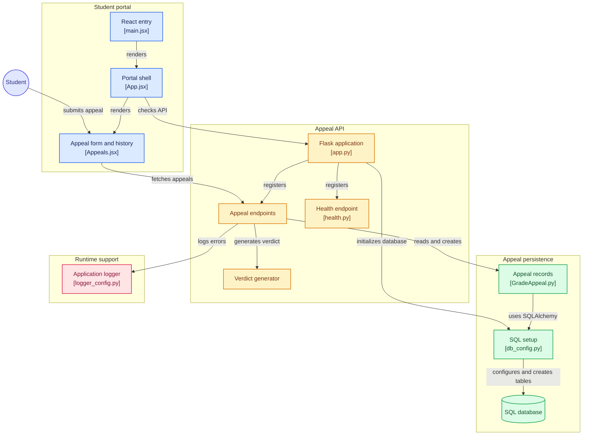

# cloud-deployments-seminar-assignment

A cloud-deployment practice project featuring a student grade-appeal portal. Students can submit grade appeals, receive automatically generated responses, and view their appeal history. The project uses React, Flask, Docker, Terraform, and Microsoft Azure.


## Tech Stack

- Frontend: React
- Backend: Python Flask
- Database: PostgresQL
- ORM: SQLAlchemy
- Containerization: Docker and Docker Compose
- Infrastructure as Code: Terraform
- Cloud Platform: Microsoft Azure


## Application Architecture

The following diagram illustrates the application's main components and how they interact, including the frontend, backend API, database, and logging layer. Deployment and infrastructure components are not included.



## Prerequisites

Before getting started, make sure you have the following accounts and tools.

### Acounts:
- [Docker Hub](https://hub.docker.com/)
- Microsoft Azure (Azure for Students is also an option)

### Tool:
- Docker and Docker Compose: Follow the Docker installation guide for Ubuntu [here](https://docs.docker.com/engine/install/ubuntu/#install-using-the-repository).
- Azure CLI: [Install Azure CLI](https://learn.microsoft.com/cli/azure/install-azure-cli), then authenticate:
```sh
az login
```
- Terraform: [Install Terraform](https://developer.hashicorp.com/terraform/install). Terraform uses your Azure CLI authentication, so no additional login is required.


## Run Locally

### Step 1: 1 Configure environment variables

Create a `.env` file in the project root directory with the following variables:

```
FLASK_PORT=8081

SQL_DB_USER=anyusername
SQL_DB_PASSWORD=anypassword
SQL_DB=anything

CORS_ORIGIN=http://localhost:3000
```

Replace the example database credentials with your own values as needed.

### Step 2: Build and start the application

Run the following command from the project root:

```sh
docker compose up --build
```

### Step 3: Access the application

Once the containers are running, open: [http://localhost:3000](http://localhost:3000).


## Build and Push Docker Images

### Build the Docker image

Use the following command to build an image and tag it with your Docker Hub username, repository name, and desired version:

```sh
docker build -t <your-dockerhub-username>/<project-name>:<tag> ./<directory>
```

For example, to build the backend image:

```sh
docker build -t thanguyen165/seminar-backend:finalpls ./backend
```

### Push the image to Docker Hub

Push the built image to your Docker Hub repository:

```sh
docker push <your-dockerhub-username>/<project-name>:<tag>
```

For example:

```sh
docker push thanguyen165/seminar-backend:finalpls
```

Make sure the image name and tag used in the docker push command match the ones used when building the image.


## Automate Backend Image Publishing with GitHub Actions

This project includes a GitHub Actions workflow at [`deploy-backend.yml`](./github/workflows/deploy-backend.yml) to automatically build and push the backend Docker image to Docker Hub.

To enable the workflow, configure Docker Hub credentials in your GitHub repository.

<details>
<summary><strong>Step 1: Generate a Docker Hub access token</strong></summary>

1. Log in to Docker Hub.
2. Click your profile picture in the top-right corner and navigate to `Account Settings`.
3. Select `Personal access tokens` from the left sidebar.
4. Click `Generate new token`.
5. Give the token a descriptive name and grant it `Repo Read & Write` permission.
6. Generate the token and copy it. Store it somewhere safe because you may not be able to view it again.
</details>


<details>
<summary><strong>Step 2: Configure GitHub repository credentials</strong></summary>

1. Open your GitHub repository.
2. Navigate to `Settings > Secrets and variables > Actions`.
3. You will see two sections: `Secrets` and `Variables`. Make sure to add each value to the correct section.

Add the following credentials:


| Type     | Name                | Value                                               |
|----------|---------------------|-----------------------------------------------------|
| Secret   | `DOCKERHUB_TOKEN`   | Docker Hub access token generated in Step 1         |
| Variable | `DOCKERHUB_USERNAME`| Your Docker Hub username                            |

</details>


<details>
<summary><strong>Step 3: Verify the automation</strong></summary>

Once the credentials are configured, the workflow is ready to use.

The workflow is configured to run automatically whenever changes are pushed to the `backend/` directory.

You can also trigger it manually:

1. Open the repository's Actions tab.
2. Select the backend deployment workflow.
3. Click `Run workflow`.
4. Monitor the workflow execution and check whether all steps complete successfully.

After a successful run, check your Docker Hub repository to verify that the new backend image has been published.

</details>


## Get Azure Account Information

Before configuring Terraform, retrieve the following information from your Azure account.

### Subscription ID:

```sh
az account show --query id -o tsv
```

### Tenant ID:

```sh
az account show --query tenantId -o tsv
```

### Deployment Region:

Azure deployment regions are geographic locations where your resources can be hosted. However, not every region is necessarily available for every subscription.

To check which regions your subscription is allowed to deploy resources to:

1. Open [Azure Policy > Assignments](https://portal.azure.com/#view/Microsoft_Azure_Policy/PolicyMenuBlade.MenuView/~/Assignments)
2. Find and select `Allowed resource deployment regions`.
3. Check the list of permitted regions.

Choose one of the allowed regions for your deployment. For example, I use `malaysiawest`.


## Deploy Infrastructure with Terraform

This project uses Microsoft Azure to host the application. The infrastructure consists of three main services:

- [Azure Container App](https://learn.microsoft.com/en-us/azure/container-apps/overview): Runs the backend Docker container and exposes the API.
- [Azure Database for PostgreSQL flexible server](https://learn.microsoft.com/en-us/azure/postgresql/overview): Hosts the application's PostgreSQL database.
- [Azure Storage](https://learn.microsoft.com/en-us/azure/storage/common/storage-introduction): Hosts the static frontend website.

The project uses Terraform (Infrastructure as Code) to automate the creation and configuration of these Azure resources.

All Terraform configuration files are located in `./infra/terraform/`. Terraform provisions the same infrastructure that you would otherwise create manually through the Azure Portal.

### Step 1. Configure Terraform variables

Create a `terraform.tfvars` file inside `infra/terraform/`:

```hcl
subscription_id = "<your-azure-subscription-id>" # az account show --query id -o tsv
location        = "malaysiawest" # Your allowed Azure region


postgres_admin_username = "anyusername"
postgres_admin_password = "anypassword"

api_image      = "thanguyen165/seminar-backend"
git_commit_sha = "0882532e7b841d6b0047c9e4ac87dcd5a2ea8866"

container_app_environment_variables = {
  NODE_ENV = {
    value = "dev"
  }
}

container_app_secrets = {}
```

Replace the example values with your own configuration.

> ⚠️ Important: terraform.tfvars may contain sensitive information, such as database credentials. Treat it like your .env file:
> 
> - Never commit it to GitHub.
> - Add it to .gitignore.
> - Keep a secure backup of the values you need.

### Step 2. Provision Azure resources

```sh
cd infra/terraform
terraform init      # download the Azure plugin (once)
terraform plan      # preview: 4 resources to add, nothing changes yet
terraform apply     # create them (type "yes"); prints website_url, storage_account_name, and backend_url
```

After successful deployment, Terraform prints several outputs, including:

- `website_url`: Public URL of the frontend website.
- `storage_account_name`: Azure Storage account name.
- `backend_url`: Public URL of the backend API.

> ⚠️ Note: Opening `website_url` at this stage may display a `WebContentNotFound` page. This is expected because the storage account has been provisioned, but the frontend files have not been uploaded yet.

### Step 3. Build the frontend

The frontend is deployed as a static website using Azure Storage.

Return to the repository root directory and build the frontend static files:

```sh
docker build \
  --target export \
  --output type=local,dest=./web-dist \
  ./frontend
```

This builds the frontend and exports its static files into the ./web-dist directory.

### Step 4. Configure the backend URL

Before uploading the frontend, update `config.js` to point to your deployed backend API.

Set `apiUrl` to the `backend_url` value generated by Terraform.

For example:

```javascript
apiUrl = "https://your-backend-url.azurecontainerapps.io";
```
Make sure to use your actual backend URL.

### Step 5. Upload the frontend to Azure Storage

Upload the generated frontend files to the $web container of your Azure Storage account:

```sh
az storage blob upload-batch \
  --account-name <storage_account_name> \
  -s ./web-dist \
  -d '$web' \
  --overwrite
```

Replace `<storage_account_name>` with the value generated by Terraform.

Once the upload finishes, open `website_url` again. Your frontend should now be accessible.

### Step 6. Configure CORS if the frontend cannot reach the backend

If it can't reach the API, set the API's `CORS_ORIGIN` to `website_url` without the trailing `/`.


## CI/CD with GitHub Actions

This project uses GitHub Actions to automate the build and deployment process. Two workflows are configured in `.github/workflows/`:

| Workflow | When               | Does |
|----------|--------------------|------|
| backend  | `backend/` changed   | Builds the image, pushes `<your-dockerhub-username>/seminar-backend:<commit>` to Docker Hub, updates the Container App |
| frontend | `frontend/` changed  | Builds the frontend, writes `config.js` with the API URL, uploads it to the static website |


Pull requests only build (nothing is deployed). Run a workflow by hand: Actions → api / web → Run workflow.

### 1. Configure Azure authentication with GitHub Actions (OIDC)

To allow GitHub Actions to deploy resources to Azure, we use OpenID Connect (OIDC).

Instead of storing an Azure password or client secret in GitHub, we configure Azure to trust a specific GitHub repository and branch. GitHub Actions can then obtain temporary Azure credentials when running a workflow.

First, we need the GitHub repository's user ID and repository ID.

#### Get the GitHub OIDC subject claim

Open the following URL, replacing the placeholders with your GitHub username and repository name:

```
https://github.com/<your-github-username>/<your-github-repository>/settings/actions/oidc-configuration
```

For example, my repository:
```
https://github.com/nqthangcs/cloud-deployments-seminar-assignment/settings/actions/oidc-configuration
```

Find and copy the Subject claim prefix. It follows this format:

```
repo:<user>@<user-id>/<repo>@<repo-id>
```

For example:
```
repo:nqthangcs@xxxxxxxxxx/cloud-deployments-seminar-assignment@xxxxxxxxxx
```

Keep this value. We will use it when configuring Azure's federated credentials.

#### Create an Azure managed identity

Create a user-assigned managed identity for GitHub Actions:

```sh
az identity create \
  --resource-group <resource-group> \
  --name id-github-deploy
```

Note the following values from the command output:

- `clientId`: Used by GitHub Actions to identify the Azure identity.
- `principalId`: Used when assigning Azure permissions.

#### Configure federated credentials

Configure Azure to trust GitHub Actions requests from the main branch:

```sh
az identity federated-credential create \
  --resource-group <api-resource-group> \
  --identity-name id-github-deploy \
  --name github-main \
  --issuer https://token.actions.githubusercontent.com \
  --audiences api://AzureADTokenExchange \
  --subject "repo:<user>@<user-id>/<repo>@<repo-id>:ref:refs/heads/main"
```

Replace the subject with the value obtained from the previous step, followed by `:ref:refs/heads/main`.

This restricts authentication to workflows running from the specified repository's `main` branch.

#### Assign Azure permissions

The managed identity needs permission to update the resources used by the deployment workflows.

For example, assign the Contributor role to the resource group:

```sh
az role assignment create \
  --role Contributor \
  --assignee-object-id <principalId> \
  --assignee-principal-type ServicePrincipal \
  --scope /subscriptions/<subscription-id>/resourceGroups/<resource-group>
```

### 2. Configure GitHub repository secrets and variables

Open your GitHub repository and navigate to: Settings → Secrets and variables → Actions

There are two sections: Secrets and Variables. Add the following values to the corresponding sections.


| Tab       | Name                    | Value                                      |
|-----------|-------------------------|--------------------------------------------|
| Secrets   | `DOCKERHUB_TOKEN`         | 	your Docker Hub access token           |
| Variables| `DOCKERHUB_USERNAME`      | 	your Docker Hub username               |
| Variables| `AZURE_APP_RESOURCE_GROUP`    | the resource group                    |
| Variables| `AZURE_CLIENT_ID`         | 	`clientId` from the managed identity   |
| Variables| `AZURE_SUBSCRIPTION_ID`   | `az account show --query id -o tsv`       |
| Variables| `AZURE_TENANT_ID`         | `az account show --query tenantId -o tsv` |
| Variables| `BACKEND_URL`             | the Container App URL, without the trailing / |
| Variables| `CONTAINER_APP_NAME`      | e.g., assignment-backend-245abc                         |
| Variables| `STORAGE_ACCOUNT_NAME`    | `storage_account_name` from Terraform (e.g., `assignmentfrontend245abc`)      |

### 3. Test the CI/CD workflows

Once everything is configured, test the automation:

1. Make a change to a file inside `backend/`.
2. Commit and push the change to the `main` branch.
3. Open the repository's Actions tab and monitor the backend workflow.
4. Verify that the new Docker image appears in Docker Hub and that Azure Container Apps has been updated.
5. Repeat the process with a change inside `frontend/`.
6. Verify that the frontend workflow completes successfully and that the updated website is available.

You can also use `Actions → Select workflow → Run workflow` to trigger either workflow manually.

If a workflow fails, open its execution details in the Actions tab to inspect the logs and identify the failing step.
